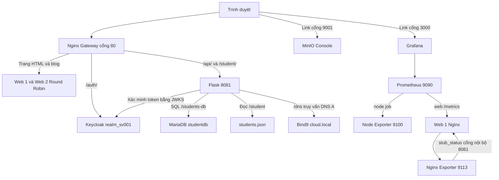

# Kiến trúc MiniCloud

Các container nằm trong cloud-net 10.10.10.0/24. DNS server .53, web 1 .10, Flask .20, MinIO .30, Keycloak .40; các service còn lại dùng IP động trong vùng .128/25. Docker DNS phân giải tên service, Bind9 được truy vấn riêng để thực hành zone và thông qua endpoint /api/dns.

| Cổng trên host | Dịch vụ nội bộ |
|---|---|
| 80 | Gateway 80 |
| 8080, 8082 | Web 1 và Web 2 cổng 80 |
| 8085 | Flask 8081 |
| 8081 | Keycloak 8080 dưới /auth |
| 3306 | MariaDB 3306 |
| 9000, 9001 | S3 API và MinIO Console |
| 1053/UDP | Bind9 53 |
| 9090 | Prometheus 9090 |
| 9100 | Node Exporter 9100 |
| 3000 | Grafana 3000 |

Gateway là điểm vào ứng dụng web/API/Auth. Console vận hành truy cập qua các link cổng riêng của portal. Security Group EC2 phải cho phép đúng cổng người demo sử dụng; không tự mở tất cả cổng ra công khai.

## Dựng hệ thống

Dockerfile web chép HTML/CSS/JS/ảnh vào image Nginx. Dockerfile backend cài các thư viện và chép app.py cùng JSON. Dockerfile MinIO biên dịch binary từ Go; storage-init dùng boto3 để tạo bucket và nạp file. Các service khác dùng image công khai. Compose tạo network/volume rồi chạy DB, backend và Keycloak với healthcheck, sau đó gateway được khởi động khi các dependency sẵn sàng.

## Luồng đăng nhập trên portal

Form gửi thông tin tài khoản tới token endpoint cùng origin /auth/realms/realm_sv001/protocol/openid-connect/token. Portal dùng access_token trong biến tạm để gọi /api/secure. Flask xác minh signature RS256, issuer, audience, expiration. Token không ghi vào localStorage. Tài khoản lab và HTTP chỉ dùng cho mô phỏng; khi chuyển thành sản phẩm cần TLS và flow Authorization Code/PKCE.
